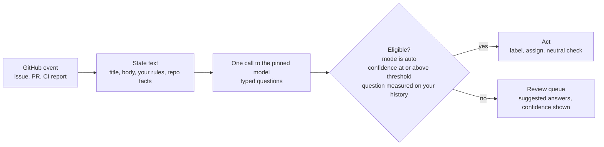

# Jev Triage

**Open-source GitHub issue triage bot. It labels, routes and screens issues and pull requests, shows its confidence, and never closes anything.**

[](LICENSE)
[](https://github.com/YOUR-ORG/jev-triage/actions/workflows/ci.yml)

Jev Triage is a self-hosted GitHub App and dashboard for maintainers who spend their week labeling issues, asking for missing details, checking PRs against CONTRIBUTING, and sorting through low-quality or AI-generated bug reports. It decides typed questions about each item, acts only where it has measured itself on your repo's own history, and queues everything else for you.

It starts in **shadow mode**: it records what it would do and changes nothing.

> Jev is a model made by [TypeSafe AI](https://typesafe.ai). Jev Triage is an independent open-source project and is not affiliated with, endorsed by, or sponsored by TypeSafe AI.

## Why

- **It decides, it does not chat.** Each item gets typed questions ("what kind of issue is this?", "are there reproduction steps?"). Each answer maps to a fixed action. Silent by default.
- **It earns trust before it acts.** Every answer carries a confidence. Auto mode acts only above your threshold, and only on questions measured against your closed issues and merged PRs.
- **It stays out of the way.** It never closes, deletes, locks or transfers anything. It has no write access to your repo contents. Every comment it posts is plain, visible text with a link to the decision behind it.

## What it decides

| Feature | Questions it answers | Typical result |
|---|---|---|
| `issue_triage` | Bug, feature, question or docs? Repro steps? Version? Logs? | Type label, `needs-info` |
| `pr_checks` | Breaking change? Follows your contributing rules? Plus exact checks in code: tests changed, docs changed, diff size, CODEOWNERS | Labels, a neutral "Jev Triage" check run |
| `routing` | Which repo? Which area? | Owner assigned, or a transfer suggestion in the queue |
| `priority` | p0 to p3 | Priority label |
| `inbound_gate` | Reproducible? Grounded in this repo? Known non-issue? Claim supported? Security claim? Same as an existing issue? | Held or queued for a human. Security-looking external reports are never filed publicly |
| `ci_gate` | Code bug, flaky test or infrastructure? Same as an open issue? | One issue instead of five, flaky tests tracked |
| `spam` | Empty or promotional with nothing to act on | Off by default |

## How it works



1. A webhook arrives (issue, PR, push) or CI posts a report.
2. The app builds a short state text from the item and your repo facts. It never includes the item's current labels.
3. One call to the decision backend asks all enabled questions.
4. Each answer comes back with a probability. Confidence is the probability of the chosen answer.
5. If the feature is in `auto`, confidence is at or above the threshold, and the question has been measured on your history, the action runs. Otherwise the item goes to the review queue with the suggested answers.
6. In `shadow` mode (the default) the decision is recorded and queued. Nothing is changed on GitHub.

When you accept or override a suggestion in the dashboard, it becomes ground truth. Measured accuracy updates. A question that drops below its threshold stops acting on its own.

## Safety promises

- **Shadow by default.** Every feature is `shadow` until you set `auto`. Spam is `off`.
- **Never closes.** No closing, deleting, locking or transferring. Transfers and duplicate links are suggestions you accept.
- **Silent by default.** Comments are off unless you set `comments: true`. When on, they are plain markdown a human can read in full, ending with a link to why the comment was made.
- **Measured before auto.** With the default `evaluation.require_evaluation: true`, a question needs at least `min_samples` (default 30) measured examples with accuracy at or above its threshold before it may act.
- **Reviewable config.** Settings live in `.github/jev-triage.yml` in your repo. Org defaults go in `ORG/.github`. The dashboard shows the YAML and a link to GitHub's web editor. It never writes to your repo.
- **Fails safe.** A typo'd key or invalid YAML makes the app fall back to the defaults, which never act.
- **Untrusted input.** Item text is data. Actions are fixed code paths per answer, so text inside a report cannot instruct the app to do something else.
- **Pinned model.** Default `jev-1.13.0`. Override per repo with `model:` or globally with `JEV_MODEL`. The version the backend reports is stored on every run.
- **No reporter profiling.** It does not build histories of who reports what, and it never claims that text was written by an AI.

Backfill accuracy is an upper bound: only items your maintainers labeled are counted, and live traffic is messier. The dashboard says so.

## Quickstart

Self-host in about five minutes with Docker Compose. You need Docker with Compose v2, a [TypeSafe API key](https://typesafe.ai), and a GitHub account or org that can own an App. Full guide: [docs/self-hosting.md](docs/self-hosting.md).

```bash
git clone https://github.com/YOUR-ORG/jev-triage.git && cd jev-triage
cp .env.example .env     # set TYPESAFE_API_KEY and SESSION_SECRET; keep DRY_RUN=true at first
docker compose up -d --build
```

Then open `http://localhost:8000/api/setup` and click **Create GitHub App**. This is GitHub's app manifest flow: the API appends the new app's credentials to `.env`. Restart with `docker compose restart api worker`, follow the install link, and open the dashboard at `http://localhost:3000`.

GitHub cannot reach `localhost`, so forward webhooks with smee or a tunnel. The self-hosting guide shows both.

First run:

1. Install the app on one repo. Everything starts in `shadow`.
2. In the dashboard, run the backfill for that repo. It replays your closed issues and merged PRs and changes nothing on GitHub.
3. Read the calibration view and the worst misses. Set thresholds from the recommended values.
4. Switch one feature to `auto` in `.github/jev-triage.yml`, then set `DRY_RUN=false`. Watch the queue.

You can also print an accuracy table from the CLI: `docker compose exec api python -m app.cli eval OWNER/REPO --limit 200`.

Public repos are enabled on install. Private repos stay off until an admin opts in and acknowledges that their content will be sent to the decision backend.

## Configuration

One file, in your repo. [docs/configuration.md](docs/configuration.md) is the full reference.

```yaml
# .github/jev-triage.yml
features:
  issue_triage: { mode: auto }     # off | shadow | auto  (default: shadow)
  pr_checks:    { mode: shadow }
  inbound_gate: { mode: shadow }

comments: false                    # silent unless you opt in

thresholds:
  issue.type: 0.90                 # defaults are per question

evaluation:
  require_evaluation: true         # act only on questions measured on your history
  min_samples: 30

labels:
  needs_info: needs-info
  issue.type:
    bug: bug
    feature: enhancement

areas:
  docs:
    owner: "@YOUR-ORG/docs"
    paths: ["docs/**"]
    description: Documentation and guides

rules_file: CONTRIBUTING.md        # PRs are scored against this
model: jev-1.13.0
```

## CI gate

CI agents and flaky tests create duplicate issues. Post the failure to the gate instead of filing it yourself. It classifies the failure, links it to an existing issue if it is the same problem, caps new issues per hour (`ci_gate.max_issues_per_hour`, default 5) and tracks flaky tests. Details: [docs/ci-gate.md](docs/ci-gate.md).

```yaml
# .github/workflows/ci.yml (fragment)
- name: Report failure to Jev Triage
  if: failure()
  env:
    JEV_URL: ${{ vars.JEV_TRIAGE_URL }}
    JEV_TOKEN: ${{ secrets.JEV_TRIAGE_CI_TOKEN }}   # created in the dashboard
  run: |
    jq -n --arg repo "$GITHUB_REPOSITORY" --arg sha "$GITHUB_SHA" \
          --arg run "$GITHUB_SERVER_URL/$GITHUB_REPOSITORY/actions/runs/$GITHUB_RUN_ID" \
          --arg log "$(tail -n 80 test.log)" \
      '{repo:$repo, title:"CI failure", body:"Automated report.", log_excerpt:$log,
        commit_sha:$sha, run_url:$run, source:"ci"}' \
    | curl -fsS -X POST "$JEV_URL/api/v1/reports" \
        -H "Authorization: Bearer $JEV_TOKEN" -H "Content-Type: application/json" -d @-
```

Outcomes are `filed`, `merged`, `flaky`, `infra`, `queued` or `rate_limited`. Reports with `source: "external"` go through the inbound gate only and are never filed publicly.

## How it compares

Short version. Full, fair version: [docs/comparison.md](docs/comparison.md).

| | Jev Triage | Conversational agents (e.g. Dosu) | Prompt-based workflows (GitHub agentic workflows, DIY LLM Actions) | Rule-based (actions/labeler, stale bot) |
|---|---|---|---|---|
| Approach | Typed questions, fixed actions | Talks in threads | Your prompt, run on events | Path or time rules |
| Confidence per decision | Stored and shown | Not the design | Model's own claim, or none | Not applicable |
| Accuracy on your history before acting | Yes | No | Only if you build it | Not applicable |
| Default behaviour | Shadow, silent | Posts comments | Whatever the prompt does | Applies its rules |
| Hosting | Self-hosted | Hosted service | GitHub or your own runners | GitHub Actions or an app |

Use `actions/labeler` for path-based labels. It is good at that. Use a conversational agent if you want answers posted in threads. Use Jev Triage when you want decisions you can measure.

## Decision backend

- **Default:** TypeSafe's Jev API (`POST /v1/systemone`), pinned to `jev-1.13.0`. Jev returns calibrated probabilities. Input is priced at $0.042 per million tokens at the time of writing. Check TypeSafe's site for current pricing.
- **Fallback:** Anthropic Claude (`DECISION_BACKEND=anthropic`). Its confidence is not calibrated, and the dashboard marks runs from it as uncalibrated, so thresholds mean much less. Use it to try the app, not to run `auto` mode.

Claude is a trademark of Anthropic. This project is not affiliated with Anthropic.

## FAQ

Trust, accuracy, privacy, cost, what happens when it is wrong, how to uninstall: [docs/faq.md](docs/faq.md).

## Documentation

- [Self-hosting](docs/self-hosting.md)
- [Configuration reference](docs/configuration.md)
- [GitHub App setup and permissions](docs/github-app.md)
- [CI gate](docs/ci-gate.md)
- [FAQ](docs/faq.md)
- [Comparison](docs/comparison.md)
- [Positioning](docs/positioning.md)

GitHub App permissions: Issues read/write, Pull requests read/write, Checks read/write, Contents read, Metadata read. Events: installation, installation_repositories, issues, pull_request, push.

## Using Jev Triage on your repo?

If you want to say so, here is a badge. It is optional.

```markdown
[](https://github.com/YOUR-ORG/jev-triage)
```

## Contributing, security, license

- Contributing: [CONTRIBUTING.md](CONTRIBUTING.md)
- Security: [SECURITY.md](SECURITY.md). Do not report vulnerabilities in public issues.
- License: [Apache-2.0](LICENSE)
